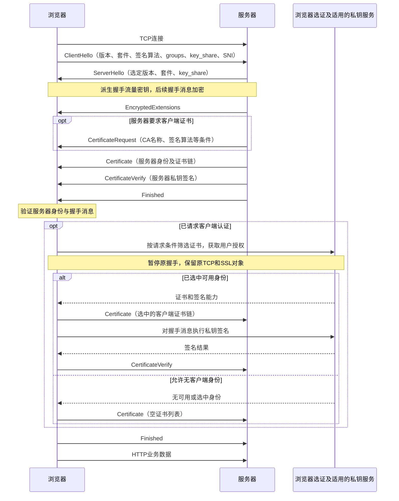
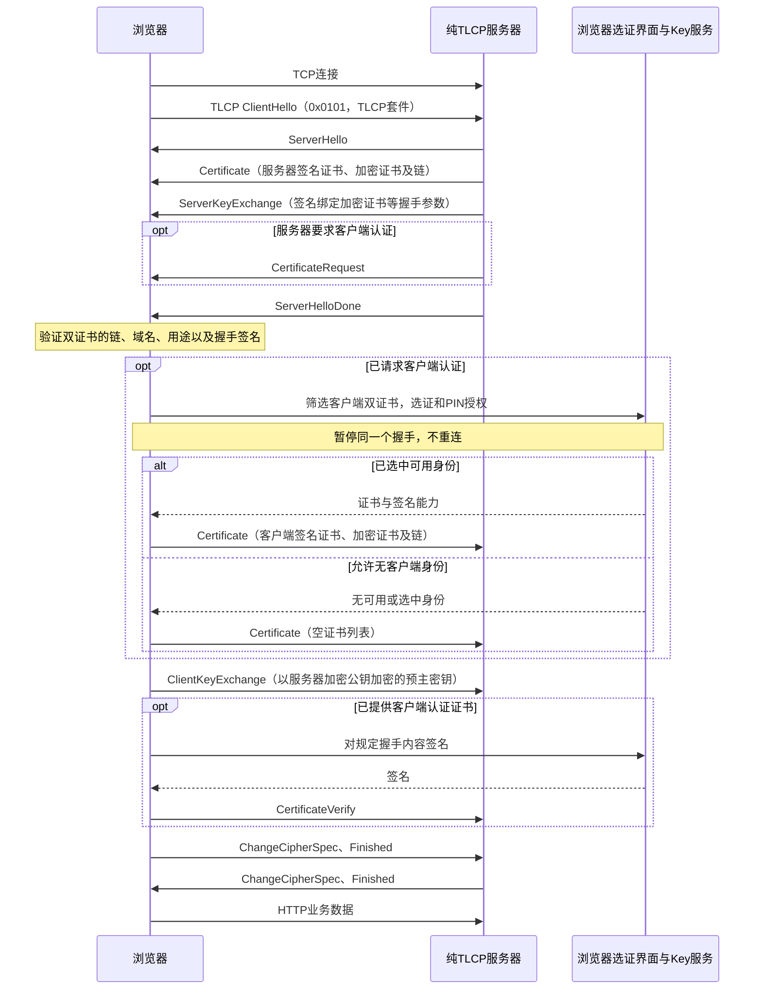
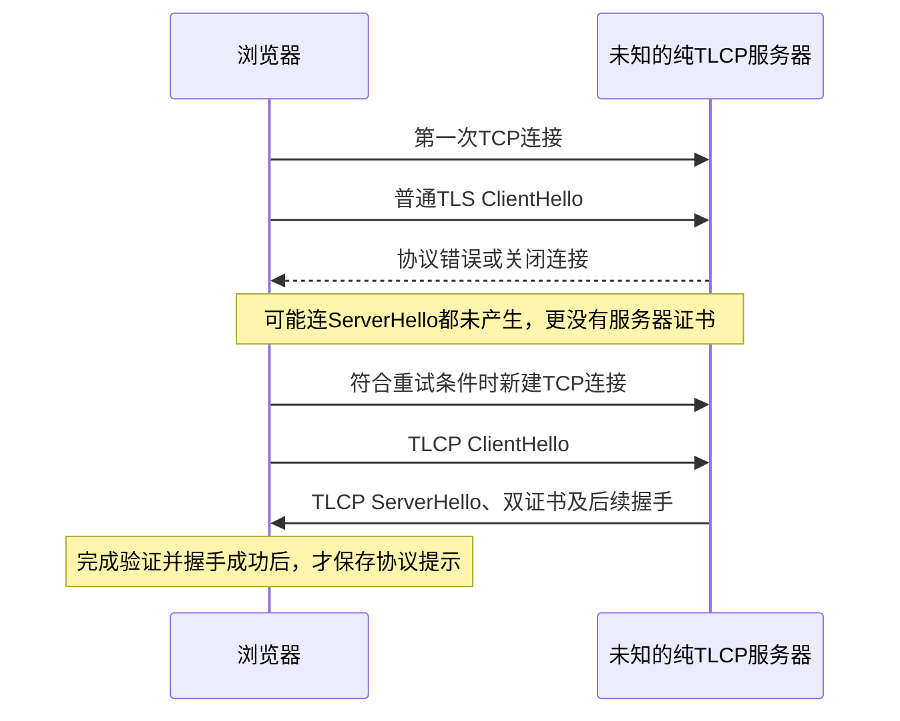

# 握手、证书与首次协议识别

说明日期：2026-10-28。以下讨论完整握手；会话恢复会省略部分证书与私钥操作。
当前生产实现使用同一份 Chromium BoringSSL，含本地静态 ECC TLCP 和 RFC 8998
TLS 1.3 扩展。铜锁仅作为源码参考及独立测试对端。

## 谁先选择协议

浏览器先发送 ClientHello，服务器从其中声明的能力选择协议参数，之后才发送证书。
服务器配置了 RSA、ECDSA、SM2 多种身份时，会按客户端能力和服务器策略选择身份。
发来的 Certificate 通常是选中身份的叶子证书及其链，不是所有候选身份的菜单。

客户端不能在未知协议下先取得服务器证书，再决定首个 ClientHello 应采用哪种格式。
普通 TLS 1.3 与 RFC 8998 使用同一个 TLS 1.3 状态机，当前已接通联合声明入口。
传统 TLCP 的版本和握手语义不同，不能仅往 TLS 的套件列表添加编号就兼容任意纯 TLCP 服务端。

## 为什么不在 ClientHello 列出全部协议

TLS 的 `supported_versions` 是协议定义的协商字段，不能单方面把它扩展成所有安全协议
都认识的通用协商入口。例如，TLS 1.3 ClientHello 的 `legacy_version` 为 `0x0303`，
`supported_versions` 可声明 `0x0304`（TLS 1.3）和 `0x0303`（TLS 1.2）。外层 record 的
兼容版本另有规则，不应把它与 ClientHello 内的版本字段混为一谈。

传统 TLCP 使用 `0x0101`，已部署实现可能先按 record/ClientHello 版本选择解析和状态机，
发现 TLS 格式便返回协议错误，尚未读取扩展。往 TLS 的 `supported_versions` 追加
`0x0101`，并不会自动给这些服务器增加识别这个扩展、选择 TLCP、切换双证书握手的代码。
反过来以 TLCP 格式开头，也不能要求普通 TLS 服务器接受。

| 服务端能力 | 一个 ClientHello 能否覆盖 |
| --- | --- |
| 普通 TLS 1.3 与 RFC 8998 | 两端实现完整算法和协商时可以；它们共用 TLS 1.3 握手 |
| 双方约定的 TLS/TLCP 混合协商 | 可以针对明确兼容的实现设计和验证 |
| 任意现有普通 TLS 与旧纯 TLCP 服务器 | 没有能单靠改客户端保证兼容的统一 ClientHello |

“同端口支持两种协议”也可能只是服务器检查首包后选择两个解析器之一，并不代表它支持
上表第二种混合协商。统一代码库能共享算法、连接管理和证书接口，但不改变线上既有服务端
对第一包的要求。未知普通站点保留原 ClientHello，不为每个连接生成额外 SM2 key share。
显式 `tls13_auto` 规则或已验证的 RFC 8998 能力记录进入联合 TLS 1.3：首包保留普通/
后量子算法，并增加 SM4、SM2 签名方案及 SM2 key share，由服务端在同次握手选择。
严格 `rfc8998`/`tlcp` 规则和已验证的 TLCP 提示仍直接选择相应协议。

联合模式选中普通套件后，继续使用 Chromium 普通证书验证和客户端证书路径；只有实际
选中国密套件才进入国密验链和 Key 桥接。国密根不会因此成为普通 TLS 信任根，普通结果
也不会新建或延长 RFC 8998 能力记录。联合模式要求 TLS 1.3，不能替代纯 TLS 1.2 服务端
的普通入口；自动学习路线遇到明确不兼容时，仍可在受限预算内重试普通 TLS。

### 独立铜锁对端的行为（参考，不是当前生产入口）

已按本地固定的 Tongsuo 8.5.0 源码核对，不能把 `SSL_CTX_enable_ntls()` 理解为
“客户端发送联合 ClientHello”。它只设置上下文开关；`TLS_client_method()` 仍进入 TLS
状态机，`NTLS_client_method()` 固定使用 `0x0101`。普通 TLS 的版本表不包含 NTLS，
套件筛选也明确禁止在 TLS 中使用 NTLS 套件。

服务器同时启用两种协议时，会预读 record header：`0x0101` 进入 NTLS，`0x03xx` 进入
TLS。这是同端口分派，不是收到一份 TLS ClientHello 后再从 TLS/TLCP 中协商选择。
相关上游位置是 `ssl/statem/statem.c` 的握手入口、
`ssl/statem_ntls/ntls_statem_lib.c` 的 `SSL_connection_is_ntls()`、
`ssl/methods.c` 以及 `ssl/t1_lib.c` 的套件版本过滤。

铜锁确实可以在 TLS 1.3 内配置普通 AES/ChaCha 与 RFC 8998 SM4 套件，并同时配置所需
SM2 群组和签名算法。`ssl/ssl_ciph.c` 的 `OSSL_default_ciphersuites(use_sm)` 就有这种
混合列表；这证明国密算法可以参与同一个 TLS 1.3 握手，但不代表传统 TLCP 也已统一。
旧双库实现按选定协议分别创建 BoringSSL、铜锁 TLS 或铜锁 NTLS 连接；该生产结构
已撤销。当前联合入口已消除已选联合路线中 AES/ChaCha 与 SM4 之间的失败重连。
未知站点仍以普通配置首连，因此首次 RFC 8998 发现也不保证零试错；这是避免让所有
普通连接承担 SM2 首包成本的取舍。未知旧纯 TLCP 的首包兼容性则不能仅靠合并库解决。
策略或经验证的成功提示可直接选择相应首包，减少重复识别。

## TLS 1.3 与 RFC 8998 完整握手

这是消息的逻辑先后，不规定它们是否装在同一个 record 或网络包中；TLS 1.3 允许合并
多个握手消息。当前 BoringSSL 在处理服务器 CertificateVerify 前完成证书验证，期间
可暂停；随后验证服务器签名与 Finished，再进入客户端选证回调。此时客户端自己的
CertificateVerify/Finished 尚未发送，选证回调触发不表示完整双向握手已完成。

联合模式的国密根/CRL 冷解析及验链在后台线程执行；取消会丢弃晚到结果，不恢复握手
或弹 PIN。严格 RFC 8998/TLCP facade 同一握手不重复验链，但仍同步验证一次。
普通套件继续使用原证书选择路径，国密套件才使用受请求约束的 SM2 Key 授权路径。

RFC 8998 采用 SM2/SM3/SM4 组合；普通 TLS 1.3 使用相应普通算法。
TLS 1.3 套件本身不编码全部证书算法，签名方案和密钥交换群组还需分别协商。
仅声明 SM4 而不实现 SM2、SM3、密钥派生及证书验证，不能构成完整 RFC 8998 支持。

如果支持的曲线列表有 SM2，但首次 key_share 没有 SM2，服务器可能发 HelloRetryRequest，
让客户端在原 TCP 上补发 ClientHello。这会增加一次往返，但不是重新建立 TCP。
首包同时提供所需 share 可避免这种原因的 HRR，代价是额外计算和字节。
当前普通网站保持原 BoringSSL 配置，不为每个普通连接额外生成 SM2 share。
联合路线首包增加 SM2 share，避免仅因漏发该 share 而触发 HRR；这仍有密钥计算和
报文字节成本。其他合法 HRR 原因不能被一概排除。联合模式保留 ECH/ALPS/TAI 设置，
关闭 early data；它不是对所有普通连接的全局配置。

## 静态 ECC TLCP 完整握手

TLCP 的两张叶子证书承担签名和加密角色，不是供客户端任选的两种协议身份。
静态 ECC 套件使用服务器加密证书公钥保护预主密钥；这不是 TLS 1.3 ECDHE，也不是
完整 TLCP SM2DHE 密钥协商。当前实现不承诺后者或 Key 侧解密能力。

## 首次选错发生在哪里

上图的第二次连接仅在错误提供足够协议证据时发生；单纯关闭连接不会触发它。
不是所有错误都证明服务端支持 TLCP。超时、TCP/代理故障、证书不可信、域名错误、
PIN 错误或用户取消，都不能一概转成国密探测。某些协议失败无法区分普通 TLS 配置错误
和国密服务端，因此不能承诺对所有失败的普通网站也完全没有额外等待。

如果服务器立即报错，首次误选通常多出一次失败连接及相应往返；若服务器静默丢弃，
等待可能更长。实际耗时取决于网络和服务器行为，不能用本地密码计算时间代表这项成本。
实现不应等普通超时后遍历所有协议。

服务器“同端口支持 TLS/TLCP”通常是它根据收到的第一包选择状态机，不表示客户端可以
发送一个对所有旧纯 TLCP、普通 TLS 服务器都有效的 ClientHello。

## 怎样减少重复工作

| 信息或机制 | 能解决什么 | 不能解决什么 |
| --- | --- | --- |
| 企业明确下发协议 | 首次即可直接选择协议 | 仍需验证证书与用户身份 |
| 已选路线的联合 TLS 1.3 | 一个 ClientHello 内协商普通/RFC 8998 算法 | 不能覆盖未知纯 TLCP；也不在所有普通站点无条件开启 |
| 经验证成功的协议提示 | 后续连接直接选用相应协议 | 不能解决从未访问站点的第一次选择，也不能作为信任根 |
| 已有连接复用 | 无需重新TCP连接和TLS握手 | 不能跨越身份/信任/网络分区约束 |
| TLS会话恢复 | 减少握手计算，通常不再选证/签名 | Key授权失效后不得继续复用其身份票据 |
| 同握手异步选证 | 不因证书选择、PIN输入而主动重建连接 | 不能让服务器握手超时无限延长 |

CertificateRequest 的 CA 字段通常是可接受的 CA 名称，不是一组客户端证书。
浏览器从本地或 USBKey 公开证书中筛选；空 CA 列表也不等于禁止所有证书。
筛选应结合算法、用途、有效期、双证配对和私钥可用性。私钥留在 Key 中，网络服务只拿
公开证书及受限签名能力。无客户端认证请求时，不因支持国密就访问 Key 或弹 PIN。

Key 的 PIN 在浏览器界面输入，经独立 SKF 服务向设备验证，网络服务不接收 PIN。
新授权采用 prepare/commit：SDK 返回成功后，浏览器还要重新确认页面请求、策略、
代次与所选证书仍有效，才能提交可复用签名授权。关闭页面、取消或拔 Key 后的晚到
成功回复不能生成授权。签名通过 BoringSSL 的异步私钥回调暂停/恢复原握手，不使用
铜锁 ASYNC，也不会为了选证或输入 PIN 主动重建连接。错误 PIN、验链失败和用户取消
均不能转成协议降级；服务器或策略要求客户端认证时，空身份不能算成功。

当前改造保持普通网站的 BoringSSL 成功路径；自动识别、同握手晚选证的具体交付状态
见 [BORINGSSL_TEST_RESULTS.md](BORINGSSL_TEST_RESULTS.md)。
[TEST_RESULTS.md](TEST_RESULTS.md) 属于历史双库记录，不能证明当前迁移已全部验收。
