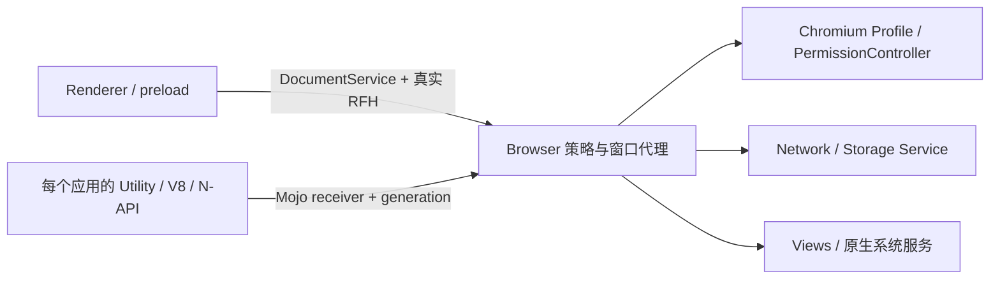

# Electron 兼容框架架构审查（2026-11-12）

## 结论

整体方向可以保留：Chromium 的 Browser、Renderer、Utility、Network 和 Storage
职责仍然存在，应用主线程 JavaScript 与原生扩展主要放在独立 Utility，窗口、权限、
会话和系统能力由 Browser 验证后代理。这一批没有重写 Chromium 的进程模型、
全局任务调度器、Blink 执行模型或网络栈。

但这已经是一套兼容运行时扩展，不能按“小范围性能优化”验收。对 Chromium 的侵入
评为**中等，部分共享 UI/权限路径风险较高**。宏开关、独立进程和功能用例通过，
都不足以证明普通浏览器完全不受影响。本次审查确认四项具体问题，并实施局部修复；
完整跨平台、component 和宏关闭编译矩阵仍未完成，不建议将整批变更作为一个
不加区分的大提交直接合并。

## 范围与方法

审查基线为 `fb689a0a58c71f7aa53d369626381925d8ce372d` 到当前工作区，包含未跟踪源码。
审查起点的清单如下；新增行包含拆分和第三方代码，不等于纯新增业务复杂度。

| 分类 | 文件数 | 新增行 | 删除行 |
| --- | ---: | ---: | ---: |
| Chromium 核心（含其构建与测试） | 75 | 1,395 | 28 |
| Overlay 原生实现与配置 | 200 | 33,036 | 1,433 |
| Overlay 测试 | 149 | 28,558 | 379 |
| JS 兼容实现 | 79 | 11,192 | 4,432 |
| 第三方依赖及生成 bundle | 57 | 18,919 | 0 |
| 文档 | 48 | 2,445 | 11 |
| 合计 | 608 | 95,545 | 6,283 |

完整变更清单保存在外部证据目录 `architecture-review-product30/changes.json`。
核心补丁按进程/沙箱、存储/权限/渲染两组审查；overlay 从可信入口、身份校验、
异步回调、退出和模块装配追踪调用链。涉及退出和 ABI 的结论做独立复核。
这不是对约九万行新增内容逐行验证完全正确的承诺。

本轮不操作用户测试窗口，不发布、提交或推送。回归使用独立测试二进制；本轮源码修复
不代表已经进入用户正在运行的浏览器。

## 主要架构边界

| 区域 | 已核实行为 | 对原有架构的影响 |
| --- | --- | --- |
| Utility 启动与环境 | 特殊启动选项要求专用接口、匹配身份和 `kNoSandbox`；普通启动默认行为保留 | 扩展了 core 公共启动接口和虚接口，属于需要维护的 Chromium fork 补丁；未发现全局放宽沙箱 |
| Renderer 与 IPC | Browser 根据 DocumentService、真实 RFH 和当前应用判定授权；窗口操作再次核对 receiver、运行代次和归属 | 普通网页没有获得 Node 权限；导航、代次替换和回调取消成为必须维护的系统不变量 |
| Session 与存储 | 默认沿用原分区；重定向时显式创建独立 Profile/Storage Service，目录锁与关闭顺序共同保护实际数据 | 未替换全部 Chromium 存储；增加专属进程和目录生命周期复杂度 |
| Cookie 加密 | 专属目录使用对应的原生 OSCrypt provider 与 Local State，普通 Profile 保留原路径 | 准备专属存储时执行 Cookie 校验以拒绝不兼容数据，成本随加密 Cookie 数量增长 |
| 权限 | 普通 Profile 也经过包装委托；非 Electron 请求再转给原生 delegate | 属于共享路径，必须验证原生属性、订阅和通知完整转发，本轮确实发现遗漏 |
| 隐藏绘制 | 多数策略绑定授权文档/hosted contents，未全局关闭后台节流 | Aura 的一个导航判断只受总宏控制，仍影响普通 widget，见后续风险 |
| Tracing、通知、抓屏 | 复用 Chromium 原有服务；Tracing 用 TracingController 的录制会话代次防止应用停止其他会话 | 全局服务需要仲裁，不能以每应用独立 Utility 推断其系统能力也完全独立 |
| N-API 与 libuv | 独立 isolate/loop、显式异步工作与 shutdown/retirement | 未改变 Chromium 全局任务调度，但兼容层承担了 Node 的线程与退出契约 |

macOS/Linux 原 Electron 产品的 keychain/keyring 兼容尚未实测。现有 Cookie 校验
可以拒绝不兼容数据，不能据此宣称旧数据必然可迁移。

## 本轮确认并修复的问题

### 1. P1：同步权限检查可重入打开文件对话框

`ElectronPermissionCheckRemote::Check` 为兼容同步 handler，在 Browser UI 线程上
开放了反向同步调用。该开关作用于整个 sequence，并不是只对白名单 getter 生效。
旧 `XenonManager::ShowElectronOpenDialog` 会进入 `kNestableTasksAllowed` RunLoop。

触发方式是在 `setPermissionCheckHandler` 内调用 `dialog.showOpenDialogSync`。
此时 Browser 已在等 Utility，Utility 又同步请求 Browser 弹窗；嵌套循环允许普通 UI
任务、窗口或文档销毁在权限调用栈中执行。独立的五秒超时只能断开管道，不能保证
已经进入模态 handler 的调用立即返回。

修复在 Browser 入口核对调用身份，并在权限同步栈中明确返回 `ERR_INVALID_STATE`。
Mojo、Utility hook、V8 接口补齐 error 通道，错误不会变成“用户取消”。新增拒绝码、
过期运行代次，以及真实反向同步调用不泵普通 UI 任务的回归。

正常打开文件流程的旧嵌套循环尚未迁移；本修复只封住新的同步重入路径。

### 2. P2：普通浏览器权限订阅丢失 embedding_origin

`xenon_electron_permission_delegate.cc` 将订阅交给原生 delegate 后，只同步部分
修改结果，漏掉 `embedding_origin`。Chrome 可在 NTP、嵌套 WebContents、MIME
扩展等场景将嵌入来源归到外层页面；后续 PermissionController 匹配权限覆盖时使用
原订阅，导致包装前后行为不一致。

修复补齐原生 `embedding_origin` 回写，增加原生 delegate 在注册期间改写该字段的
回归。此问题说明普通浏览器委托转发也必须测试，不能只测试 Electron 主流程。

### 3. P2：SandboxDelegate 的新增 key function 破坏 component 链接

原接口为 header-only。新增到 `.cc` 的非 inline 虚函数成为 Itanium ABI 的 key
function，但只有方法导出，类的 vtable 在 hidden-visibility 共享库中仍可能不可见。
使用 Clang 的 Linux target 与 `ld.lld` 两个真实 DSO 已复现
`undefined symbol: vtable for Delegate`。

修复保留 `.cc` 中的默认虚函数，并在 Xenon 宏开启时对整个类使用
`SANDBOX_POLICY_EXPORT`，确保方法和 vtable 同属可见接口；宏关闭时保留原类声明。
同一 Linux 双 DSO 链接探针由失败变为成功。内联非空虚函数会被 Chromium style
plugin 拒绝，因此最终采用类级导出的标准形式，不禁用规范检查。
这是该 C++ ABI 模式的编译/链接验证，不等同于完整 Linux/macOS Chromium 编译。

### 4. P2：环境退出后仍等待未使用的 TSFN owner token

N-API TSFN 环境关闭时已经 abort，且队列、活动调用均为空、finalizer 已结束，
实现仍要求逻辑 `thread_count` 降为零。合法插件可能在 cleanup 停止事件源、
finalizer 清理对象，但不显式 release 初始 owner token；Node 环境强制清理支持这种模式。
本实现会使环境一直留在 pending 集合，最终触发三十秒退出 watchdog。

这与 MarkText 的 pending native environment 日志吻合，且其 native-keymap 同版
源码使用该模式；未将日志直接归因到具体模块，产品因果链仍应由后续实际重开验证补足。

修复明确区别“整个环境退出”和普通 `napi_tsfn_abort/release`：环境退出仍等待
队列、活动调用和 finalizer 屏障，之后不等待失效的逻辑 owner token；普通 abort
保留原 token 生命周期。新增用例在修前按预期失败，修后完整 N-API 套件 63 项通过。

## 审查时识别的影响与规范问题

以下保留审查时的证据；用户要求后的实现进展见末节“后续修复”。

1. **普通网页授权探测有同步成本。** 所有启用 overlay 的 renderer 都继承总开关。
   每个非 provisional 主世界上下文（包括 iframe）会尝试获取运行配置；未授权文档
   在 Browser 拒绝后退出，不加载完整 bootstrap。原 HTTPS 页面已有此路径，本批
   删除 secure-context 条件又扩展到普通 HTTP/custom/opaque 上下文。Browser UI
   繁忙时会延长页面脚本启动。建议 Browser 下发每文档资格提示用于提前跳过，最终
   授权仍由 Browser 持有；简单恢复 secure-context 条件会破坏合法 Electron HTTP。

2. **同步权限 handler 仍可能阻塞共享 UI，最长约五秒。** 独立 deadline 和拒绝时
   关闭权限保证有界，但不保证浏览器流畅。保留该契约时必须审计每个反向同步入口，
   并限制昂贵、模态或异步依赖操作；长期优先异步权限请求和可缓存的同步查询。

3. **默认 userData 不是每应用独立目录。** 历史路径沿用宿主 `DIR_USER_DATA`，
   `sessionData` 分区虽隔离，应用用普通 fs 写 `userData/config.json` 等仍可能重名。
   这是兼容历史数据的存量策略，尚未证明本次发生覆盖。通用第三方接入前应制定
   新应用命名空间与已有应用迁移规则，不能无提示移动现有数据或加入应用名称特判。

4. **固定 libuv 轮询有空闲成本。** 主运行时及加载 addon 的 executor 按 10 ms
   调度，每个活动 loop 约一百次唤醒/秒。它不修改 Chromium 全局调度器，但会随应用
   数量累加。应基于 uv backend 就绪事件和下一 deadline 调度；不能简单在
   `uv_loop_alive == false` 时永久停泵，否则 unref handle 和稍后 native 回调会失效。
   本轮没有 CPU/功耗实测，不将静态唤醒频率当作测得的 CPU 回归。

5. **bootstrap 明显膨胀。** 组合后的 main 从 319,082 增到 1,087,459 字节（3.41 倍），
   renderer 从 317,388 增到 813,844 字节（2.56 倍）。新增标准库复用有合理性，
   第三方来源、许可证和确定性 bundle 也已记录；但完整兼容层应按角色/需要初始化，
   并测冷启动、首帧、峰值内存，不能把源码拆分当作性能提升。普通未授权页面不加载
   这两份完整脚本，不能将体积增长直接计入所有网页。

6. **Aura 导航判断的运行范围偏宽。** `RenderWidgetHostViewAura::DidNavigate`
   在总宏开启时，对所有 widget 使用 `!IsShowing() && host()->IsHidden()`。
   其依据是保持绘制的隐藏 Electron 窗口，并与现存 Mac compositor 语义一致；
   目前未证实普通窗口回归。后续应限定到相应绘制策略，或补普通隐藏、捕获和恢复
   转换的浏览器级回归，不能仅用 PLE 出帧证明全部窗口行为无影响。

7. **核心依赖与大模块增加升级负担。** base/mojo/sandbox/content 公共层依赖 overlay
   buildflags，content/browser 还依赖 overlay 队列与启动配置。配置头本身较轻，
   但可复用的 core 扩展协议应逐步内聚到对应核心组件，overlay 作为调用者。
   main container 约 6,000 行、manager 约 3,000 行，按生命周期、可信路由、Node
   模块拆职责更有价值；不为行数机械拆文件，不额外增加运行时 require 层级。

8. **存量 open dialog 仍不满足完整通用标准。** 原 helper 是 Windows COM 实现，
   非 Windows 返回空数组；父窗从全局窗口表选择，过滤器标签固定，部分系统失败
   也表现为取消。当前新增 message/save 使用跨平台 Views/SelectFileDialog。
   后续应将 open 迁到同一异步、归属明确的通用能力，本轮只修同步重入与错误通道。

## 验证与限制

本轮证据根目录：`F:/electron-compat-audit/20261111/architecture-review-product30/`。

| 检查 | 结果 |
| --- | --- |
| 完整变更清单、来源分类与 bootstrap 体积 | 已保存 `changes.json`、`bootstrap-size.json` |
| 关闭 Xenon 的 GN 图 | 成功：32,833 targets；须同时关闭应用打包列表，原配置保留在独立输出目录 |
| 关闭 Xenon 的 content/public/browser 头依赖检查 | 通过；不是全部宏关闭二进制编译 |
| SandboxDelegate 跨 DSO 符号探针 | 修前链接失败，最终类级导出后链接成功；见 `component-symbol-probe/link-class-export.log` |
| TSFN 红灯复现与绿灯回归 | 新用例修前失败；修后完整 N-API 套件 63/63 通过，见 `napi-green-full-01.json` |
| 独立原生回归 | N-API 63/63、IPC 611/611、Session 141/141、同步权限 16/16，共 831/831；没有失败重试 |
| open 错误通道与权限字段专项 | IPC 错误透传和 Session 原生 embedding_origin 回写新用例均通过，包含在上述套件中 |
| Manager 身份与同步重入回归 | 生产和测试对象编译成功；未链接/运行完整 Chromium `unit_tests.exe`，不能把这些用例记为运行通过 |
| 最终本机编译与差异检查 | 独立目标构建成功（`green-build-02.log`）；`git diff --check` 通过 |
| 全量 macOS/Linux/component、宏关闭全编译 | 未完成；Windows 单体产品成功不能替代此矩阵 |
| 普通浏览器性能与隐藏/捕获转换 | 静态影响已识别，未进行本轮浏览器性能基准 |

product30 之前的 1396 项 JS、610 项 IPC、10 项对话框和应用人工验收，证明既有功能
基线，不作为本轮新增修复已经进入运行产品的证据。既有应用验证详见
[Electron原包兼容性验证.md](Electron原包兼容性验证.md)。

本轮独立编译和测试汇总见 `native-verification-summary.json`；最终关闭 Xenon 的
构建图和头依赖证据分别为 `gn-no-xenon-final-02.log`、`gn-no-xenon-check-final.log`。
没有链接或替换 `xlbrowser.dll`，没有操作用户产品进程，四项修复仍待后续产品构建发布。

## 收敛顺序

本轮四项局部修复和独立回归已完成，Manager 用例仍受上述运行范围限制。下一步优先
减少普通网页同步探测、建立新应用
userData 隔离规则、迁移 open dialog 的嵌套循环。随后建立冷启动/空闲唤醒/多应用
内存预算与跨平台构建矩阵，再考虑有证据支持的拆分和懒初始化。

提交应按 core 扩展、应用隔离/权限、N-API 退出、Node 模块、Electron UI、测试接入
分批组织。每批说明触发条件、默认 Chromium 行为、宏开关和验证范围；不用一个
“性能优化”标题覆盖整套兼容运行时的功能扩展。

## 后续修复（2026-11-12）

用户要求修复后，以下变更在原工作区实施，均保持通用框架行为，不修改应用发行包。

1. **普通网页先本地跳过授权探测。** Browser 根据已登记的 Electron
   StoragePartition 为应用 renderer 下发候选标记，同时传递宿主明确配置的来源提示。
   普通 renderer 只有主文档命中精确来源或开发 allow-all 模式才请求配置；普通 iframe
   直接跳过。应用分区中的 HTTP、file、custom、opaque 文档仍请求 Browser 校验。
   这是保守的进程级负向提示，不是新的授权能力；IpcDocumentHost 的真实文档、归属和
   运行代次检查保留，也没有新增 Blink preferences 或导航协议字段。新增普通页面、
   端口/近似域名、应用分区、禁用总开关和开发模式回归。`--single-process` 无子进程
   提示，保守保留原 Browser 探测；它仍须开启总开关并通过真实授权。

2. **缩小 Aura 例外范围。** hidden surface allocation 策略默认关闭，仅由 embedder
   对具体 widget 显式启用。Electron 初次隐藏绘制、关闭 backgroundThrottling 时设置，
   窗口状态转换时更新；普通标签页即便 native/renderer 可见性暂时不一致，也恢复原有
   延迟分配判断。核心接口和行为继续受 `ENABLE_XENON_SERVICE` 保护。
   独立 WebContentsView/guest 自身的原生 backgroundThrottling 生命周期仍未完整实现，
   不能将本轮 BrowserWindow 收口解释为该能力已经覆盖所有 guest；Mac 不使用 Aura 分支。

3. **默认 userData 隔离。** 新应用使用宿主目录下
   `ElectronApps/<稳定身份 SHA-256>/UserData`。身份优先 `storageId`，其次非默认
   container ID；裸 CLI 默认容器才回退安装路径。现有 TH、PLE、DIO、MT、MX 的接入配置
   显式声明 `userDataPolicy: "legacy-host"`，避免移动或遗漏旧数据，不按应用名称特判。
   普通 fs 文件因此可以按应用隔离；默认 sessionData 分区保持原位，app.setPath 规则
   保留。目录在后台创建成功后才启动 Utility，初始化和后续 IPC 通过同一待绑定管道保序。
   带版本号的裸 CLI 安装路径应声明固定 storageId。详见应用数据目录设计文档。

4. **打开文件通道统一。** main 和两个旧 WebUI controller 共用跨平台 SelectFileDialog，
   删除旧 Windows COM/GetOpenFileName 实现、跨应用父窗扫描和适配层自建 RunLoop。
   async API 使用异步桥接，sync API 仅在调用方等待；Browser handler 提交选择器后返回。
   owner/generation 销毁、取消、错误与迟到回调分别处理。Chromium 公共选择器未暴露的
   显式选项返回 ERR_NOT_SUPPORTED，平台自身模态行为仍由 Chromium 管理。

5. **停止已清空 UDP 循环的空转。** 单个 OneShotTimer 在没有成功或保留失败的 addon、
   且 native handles/requests 完全清空后停止；后续 dgram/addon 调用自动重启，并防止
   uv 回调重入重复安排 pump。真实双 unref UDP 回归覆盖通信、关闭后零待执行任务与重开。
   从未使用 native/dgram 原本就没有 timer，不将其计为新增收益。

6. **延迟 Web Streams 初始化。** 无原生实现的主运行时按首次使用加载 ponyfill，
   该模式的 Node↔Web adapter 同样延迟创建；保留原构造器、可写全局和 fs/net 的继承身份。
   readable-stream 本身仍由这些继承链需要，不用代理构造器强行延期。该优化降低未使用
   时的初始化成本，不减少组合脚本体积。控制变量 VM 测量（40 次预热、200 组交替样本）
   main 执行中位数 2.6852 → 2.5602 ms，节省约 0.125 ms；首次 Web API 访问
   0.0042 → 0.2198 ms，说明成本被延期。该测量不含编译、Chromium 启动或原生任务。
   renderer 未测得改善，最终保留原生家族的直接初始化。main/renderer 脚本增加约
   3.5/3.3 KB，不能宣称减小注入体积。证据为
   `F:/electron-compat-audit/20261112/bootstrap-streams/controlled-results.json`。
   补充了每样本独立进程、禁用 compilation cache 的“源码编译＋首次执行”对照；
   但并发构建下 main 仅 12/20 对变快、差值四分位区间跨零，不能据此宣称稳定冷启动
   改善或给出冷启动收益。原始样本见同目录 `compile-first-execution-results.json`。

还不能无损消除的边界：同步权限 handler 要返回任意 JS 闭包的即时结果，仍需有界等待；
Windows 公开 libuv backend 不提供可直接等待的 fd，且 addon 可能依赖原生窗口消息，
已加载 addon 的循环仍保守轮询。彻底事件驱动需要独立 IOCP/消息等待整合与跨平台回归。
核心模块职责拆分及完整平台构建矩阵也未被这些局部修复替代。

本轮证据目录为 `F:/electron-compat-audit/20261111/architecture-fixes-product31/`。
最终验证如下；本节记录此次六项后续修复的结果，不沿用上一轮的 831 项原生计数。

| 检查 | 结果 |
| --- | --- |
| IPC JavaScript 全量及真实 GC 回归 | 1404 个不同用例通过，14 项按平台/外部样本条件跳过，无失败；见 `javascript-full-01.log`、`javascript-gc-01.log` |
| Web Streams 补充回归 | 最新专项 25/25 通过，包含冻结/封闭导出及替换原生全局构造器；与全量重复的用例不累加 |
| 旧 WebUI 打开文件调用链 | 适配器 2/2 通过；同版 TypeScript 编译器 `--noEmit` 通过；两个正式 WebUI `build_grd` 目标构建成功 |
| 六套独立原生回归 | N-API 63、IPC 614、Session 144、同步权限 16、Dialog 14、ContextBridge 19，共 870/870 通过；单次运行、无失败重试 |
| 新行为原生覆盖 | renderer 候选提示、应用目录策略、UDP unref/清空/重开、打开文件参数与错误通道包含在上述套件中 |
| Chromium 接入对象 | Manager、Chrome browser client、renderer observer、Aura、window host、两个 WebUI controller、service impl 及指定测试对象编译成功；Manager/Aura 测试未在完整 Chromium 测试程序中运行 |
| 最终构建与差异检查 | `native-build-03.log` 退出码 0；`git diff --check` 通过；原生明细见 `native-verification-summary.json` |
| 关闭 Xenon | GN 图生成成功（32,833 targets），content/public/browser 头依赖检查通过；不等于宏关闭全编译 |
| 平台与性能限制 | 未完成完整 macOS/Linux/component 构建、产品运行回归或浏览器性能基准；上述 VM 测量不能替代冷启动/功耗测量 |

没有链接或替换产品 `xlbrowser.dll`/EXE，没有覆盖产品根目录资源包或操作用户运行中的
浏览器，也没有改动应用发行包。此次源码修复和独立验证已完成，尚未进入当前运行的产品；
本次未提交或推送代码。
